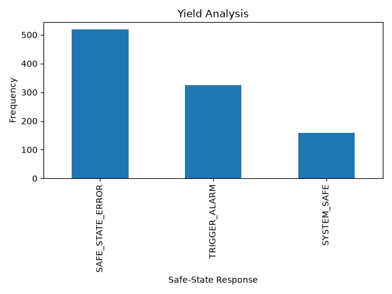

# Virtual-ATE-Validation-Framework

The Virtual ATE Validation Framework is a software-based project that shows you know how to connect hardware limits with automated testing. First, build a basic C program to act as a physical device, using fixed memory to keep it safe from crashing. Next, write a Python script that automatically sends both normal commands and intentional errors to this C program to make sure it handles bad data correctly. Finally, your Python script runs this test 1,000 times, saves the speed and error data, and creates a simple bar chart to show the final results.

